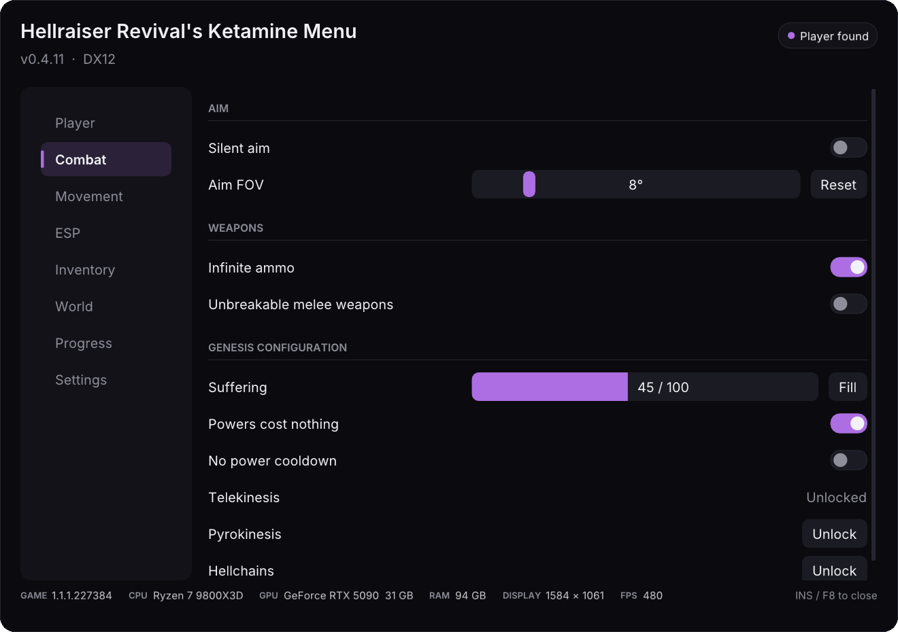
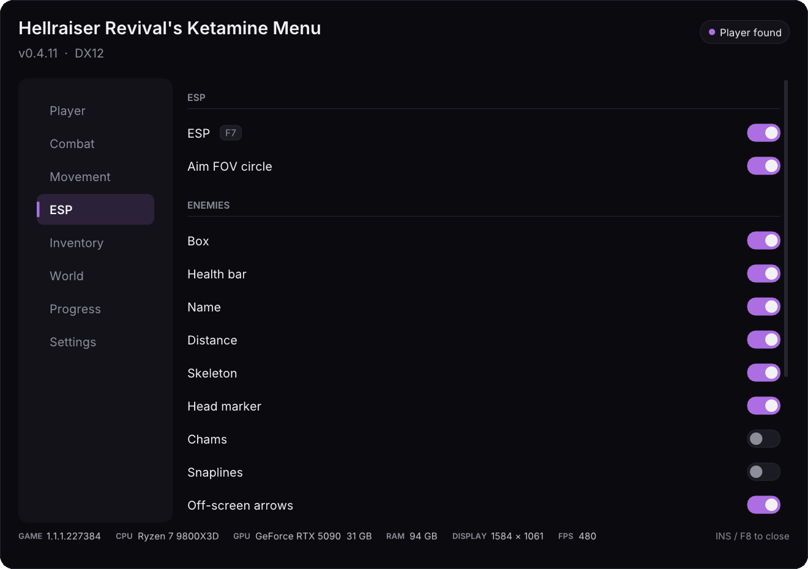
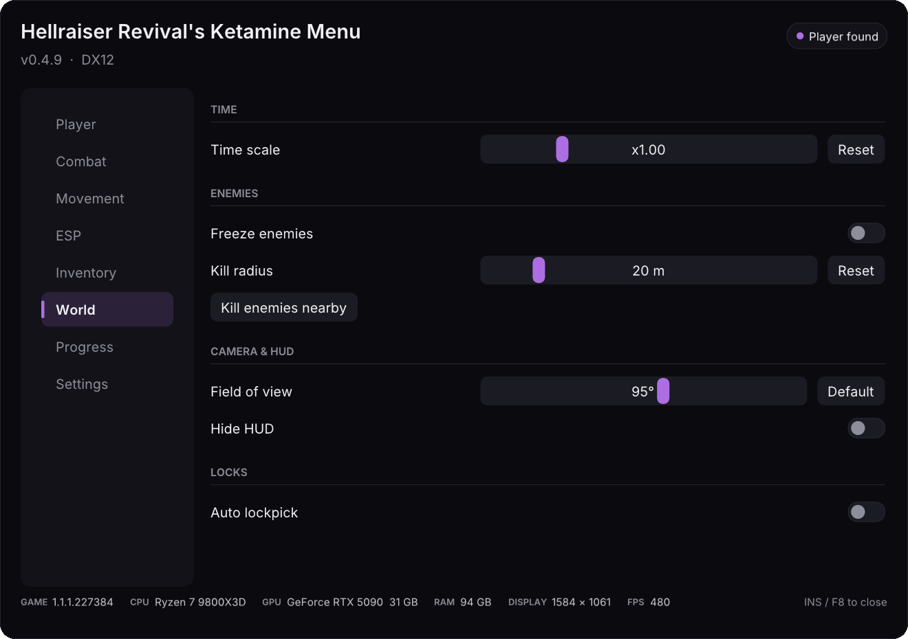
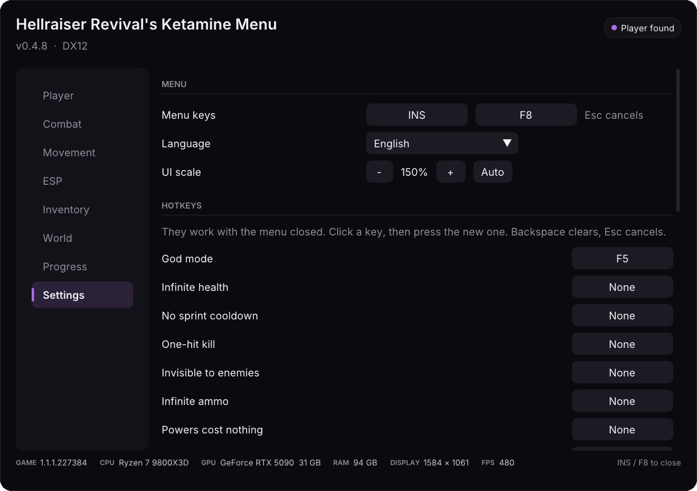

<p align="center">
  
</p>

<p align="center">
  <a href="README.md">English</a> ·
  <a href="README.zh-CN.md">简体中文</a> ·
  <a href="README.ja.md">日本語</a> ·
  <a href="README.ko.md">한국어</a> ·
  <a href="README.ru.md">Русский</a> ·
  <b>Deutsch</b> ·
  <a href="README.fr.md">Français</a> ·
  <a href="README.es.md">Español</a> ·
  <a href="README.pt-BR.md">Português (Brasil)</a>
</p>

<h1 align="center">Hellraiser Revival's Ketamine Menu</h1>

<p align="center">
  Ein aufgeräumter In-Game-Trainer für <b>Clive Barker's Hellraiser: Revival</b> (PC).<br>
  Eine Datei in den Spielordner legen, <kbd>Einfg</kbd> (Insert) oder <kbd>F8</kbd> drücken, fertig.
</p>

<p align="center">
  <a href="https://github.com/literalynn/Hellraiser-Revivals-Ketamine-Menu/releases/latest"></a>
  <a href="https://www.nexusmods.com/clivebarkershellraiserrevival/mods/27"></a>
  <a href="https://github.com/literalynn/Hellraiser-Revivals-Ketamine-Menu/actions/workflows/build.yml"></a>
  
  
  <a href="LICENSE"></a>
</p>

<p align="center">
  <a href="#installation">Installation</a> ·
  <a href="#funktionen">Funktionen</a> ·
  <a href="#das-menü-benutzen">Bedienung</a> ·
  <a href="#faq--fehlerbehebung">FAQ</a> ·
  <a href="#deinstallation">Deinstallation</a> ·
  <a href="#aus-dem-quellcode-bauen">Bauen</a>
</p>

---

> [!TIP]
> **Sichere deine Spielstände**, bevor du loslegst: `%LOCALAPPDATA%\Hellraiser\Saved\SaveGames`.

## Installation

Du brauchst nur eine Datei und musst nichts auf deinem PC installieren (kein Visual C++ Redistributable, kein Launcher).

1. **Lade** die neueste `KetamineMenu-vX.Y.Z.zip` von der [Releases-Seite](https://github.com/literalynn/Hellraiser-Revivals-Ketamine-Menu/releases/latest) herunter und entpacke sie.
2. **Öffne den Spielordner**: Rechtsklick in Steam auf *Clive Barker's Hellraiser: Revival* → **Verwalten** (Manage) → **Lokale Dateien durchsuchen** (Browse local files).
   Dann `Hellraiser` → `Binaries` → `Win64` öffnen (der Ordner mit `Hellraiser-Win64-Shipping.exe`).
3. **Kopiere `winmm.dll` in diesen `Win64`-Ordner.** Optional auch `KetamineMenu.ini` (Standardeinstellungen).
4. **Starte das Spiel**, lade einen Spielstand und drücke <kbd>Einfg</kbd> oder <kbd>F8</kbd>.

```
Clive Barker's Hellraiser - Revival\
└─ Hellraiser\
   └─ Binaries\
      └─ Win64\
         ├─ Hellraiser-Win64-Shipping.exe
         ├─ winmm.dll            ← Ketamine Menu
         └─ KetamineMenu.ini     ← optional, wird sonst automatisch erstellt
```

**Vortex:** auf der [Nexus-Mods-Seite](https://www.nexusmods.com/clivebarkershellraiserrevival/mods/27) über *Mod Manager Download*.

**Manuell „in den Spielordner entpacken“:** nimm stattdessen `KetamineMenu-vX.Y.Z-Nexus.zip`. Es enthält bereits die Ordner
`Hellraiser\Binaries\Win64\`, also installiert Vortex es an die richtige Stelle, oder du entpackst es direkt in den Spielordner.

**Linux / Steam Deck (Proton):** Proton lädt seine eigene `winmm.dll` statt der des Menüs. In Steam: Rechtsklick aufs Spiel → **Eigenschaften** (Properties) → **Startoptionen** (Launch Options) und `WINEDLLOVERRIDES="winmm=n,b" %command%` eintragen.

> [!TIP]
> Wenn <kbd>Einfg</kbd> / <kbd>F8</kbd> nichts tun, öffne `KetamineMenu.log` neben der DLL: dort steht genau, was gefunden wurde und was nicht.
> Siehe [FAQ](#faq--fehlerbehebung).

## Funktionen

Jede Option sucht die Daten des Spiels **zur Laufzeit über ihren Namen**. Entfernt ein Spielupdate etwas, wird die Option ausgegraut und
der Grund steht im Tooltip, statt dass das Spiel abstürzt.

<table>
<tr>
<td width="50%" valign="top">

**Spieler**
- Gottmodus, unendliche Gesundheit
- Gesundheitsregler (beliebiger Wert)
- Keine Sprint-Abklingzeit *(das Spiel hat keine Ausdauer)*
- Unsichtbar für Gegner
- One-Hit-Kill, Schadensmultiplikator

**Kampf**
- Unendliche Munition
- Unzerstörbare Nahkampfwaffen
- Kräfte der Genesis-Konfiguration ohne Leid-Kosten
- Keine Abklingzeit für Kräfte, Leid auffüllen
- Telekinese, Pyrokinese und Höllenketten vor der Story freischalten
- Silent Aim: deine Schüsse treffen den Kopf des Gegners, der dem Fadenkreuz am nächsten ist, in einem einstellbaren Kreis

**Bewegung**
- Fliegen und Noclip in Blickrichtung, mit deinen üblichen Bewegungstasten oder dem Gamepad
- Freie Kamera (deine Figur bleibt stehen)
- Multiplikatoren für Tempo und Sprunghöhe
- 3 gespeicherte Positionen + Teleport zu jedem Checkpoint des Levels

</td>
<td width="50%" valign="top">

**ESP**
- Gegner: Box, Lebensbalken, Name, Entfernung, Skelett, Kopfmarkierung, Chams, Snaplines, Pfeile außerhalb des Bildschirms
- Welt: Gegenstände am Boden, Beutebehälter, Speicherpunkte
- Getrennte Reichweite für Gegner und Objekte

**Inventar**
- Geld hinzufügen oder entfernen
- Beliebige Gegenstände: Munition, Waffen, Upgrades, Heilung, Materialien (Liste kommt direkt aus dem Spiel)
- Waffen-Skins und Anhänger freischalten

**Welt**
- Zeitskala (Zeitlupe / Zeitraffer)
- Gegner einfrieren, Gegner in der Nähe töten
- Sichtfeld-Editor (FOV, 50° bis 130°, live), HUD ausblenden
- Auto-Schlossknacken: Schlösser öffnen sich von selbst
- Logos und Hinweise beim Start überspringen (rund 30 s gespart)

**Fortschritt**
- Aktive und abgeschlossene Ziele ansehen, ein Ziel abschließen, Shop-Stufe ändern

</td>
</tr>
</table>

### Screenshots

<table>
<tr>
<td></td>
<td></td>
</tr>
<tr>
<td></td>
<td></td>
</tr>
<tr>
<td></td>
<td></td>
</tr>
</table>

## Das Menü benutzen

| | |
|---|---|
| <kbd>Einfg</kbd> / <kbd>F8</kbd> | Menü öffnen / schließen (beide Tasten in den **Einstellungen** änderbar). Solange es offen ist, steuert die Maus das Menü und das Spiel ignoriert deine Eingaben. |
| Tastenkürzel | Jeder Schalter kann unter **Einstellungen → Tastenkürzel** eine eigene Taste bekommen. Sie funktionieren auch bei geschlossenem Menü und zeigen eine kleine Benachrichtigung. |
| Tooltips | Fahre mit der Maus über eine Option, um zu sehen, was sie tut oder warum sie nicht verfügbar ist. |
| Sprache | English, 简体中文, 日本語, 한국어, Русский, Deutsch, Français, Español, Português (Brasil): startet in deiner Windows-Sprache, änderbar unter **Einstellungen → Sprache**. |
| UI-Skalierung | Passt sich deiner Bildschirmauflösung an; mit den Tasten − / + in den **Einstellungen** anpassbar. |
| Fußzeile | Spielversion, CPU, GPU, RAM, Auflösung und FPS auf einen Blick, unten im Menü. |
| Einstellungsdatei | Alles wird in `KetamineMenu.ini` neben der DLL gespeichert. **Einstellungen → Konfiguration zurücksetzen** stellt die Standardwerte wieder her. |

> [!WARNING]
> Schlüsselgegenstände geben oder Ziele abschließen kann geskriptete Abläufe kaputt machen. **Speichere vorher.**

## Kompatibilität

- **Spiel:** getestet mit Version `1.1.1.227384` (Steam, Update vom Oktober 2026) und `1.0.1.227219`. Andere Versionen können funktionieren:
  Was nicht gefunden wird, ist ausgegraut.
- **Renderer:** DirectX 12 (Standard) und DirectX 11.
- **Andere Mods:** das Menü nutzt `winmm.dll` und kommt deshalb ReShade (`dxgi.dll`) und UE4SS (`dwmapi.dll`) nicht in die Quere.
- **Frame Generation** (DLSS-G, FSR, XeSS FG): unterstützt, aber wenn das Menü flackert, schalte Frame Generation aus.

## FAQ / Fehlerbehebung

<details>
<summary><b>Einfg / F8 tun nichts</b></summary>

- Prüfe, ob `winmm.dll` in `Hellraiser\Binaries\Win64` liegt (neben `Hellraiser-Win64-Shipping.exe`) und nicht im obersten Spielordner.
- Öffne `KetamineMenu.log` im selben Ordner. Gibt es die Datei nicht, wurde die DLL nicht geladen: prüfe noch einmal den Ordner und deinen Virenscanner.
- Wenn du die Menütaste geändert hast, zeigt die Fußzeile des Menüs (und `KetamineMenu.ini`, `[Menu] Key=` / `Key2=`) die aktuellen Tasten.
</details>

<details>
<summary><b>Alles ist ausgegraut</b></summary>

Lade zuerst einen Spielstand: die meisten Optionen brauchen eine Spielfigur. Steht oben *Engine nicht verbunden*, hat sich die Spielversion so geändert,
dass das Menü noch nicht damit umgehen kann. Bitte öffne ein Issue und hänge `KetamineMenu.log` an.
</details>

<details>
<summary><b>Mein Virenscanner meldet die DLL</b></summary>

Trainer hängen sich in Rendering und Speicher eines Spiels ein, was Virenscanner-Heuristiken nicht mögen. Das ist ein Fehlalarm: der Quellcode liegt
hier, und jedes Release wird von [GitHub Actions](https://github.com/literalynn/Hellraiser-Revivals-Ketamine-Menu/actions) daraus gebaut.
Du kannst es auch [selbst bauen](#aus-dem-quellcode-bauen).
</details>

<details>
<summary><b>Nach einem Spielupdate funktioniert etwas nicht mehr</b></summary>

Optionen, die nicht mehr gefunden werden, sind mit Begründung ausgegraut. Öffne ein Issue mit deiner `KetamineMenu.log` und der Spielversion
(`Version.txt` im Spielordner).
</details>

<details>
<summary><b>Wie melde ich einen Fehler?</b></summary>

[Öffne ein Issue](https://github.com/literalynn/Hellraiser-Revivals-Ketamine-Menu/issues) mit dem, was du getan hast, was passiert ist, und der Datei
`KetamineMenu.log` deiner letzten Sitzung (sie wird bei jedem Spielstart überschrieben).
</details>

## Deinstallation

Lösche `winmm.dll`, `KetamineMenu.ini`, `KetamineMenu.log` (und `KetamineMenu-LICENSE.txt`, falls du das Nexus-Zip benutzt hast) aus
`Hellraiser\Binaries\Win64`. Mit Vortex: Mod entfernen, dann die übrig gebliebenen `.ini` und `.log` löschen. Es wird nie eine Spieldatei verändert.

## Aus dem Quellcode bauen

Voraussetzungen: Windows, Visual Studio 2022 oder neuer mit dem Workload *Desktopentwicklung mit C++*, CMake 3.25+.

```bash
cmake -S . -B build -A x64
cmake --build build --config Release
ctest --test-dir build -C Release
```

Die DLL liegt dann unter `build\Release\winmm.dll`. Dear ImGui und MinHook lädt CMake in festen Versionen mit Prüfsummen herunter.
Ein gepushter `v*`-Tag baut das Release-Zip automatisch.

<details>
<summary><b>So funktioniert es</b></summary>

- **Laden:** das Spiel importiert `winmm.dll`, deshalb lädt Windows zuerst unsere aus dem Spielordner. Jede `winmm`-Funktion wird an die echte
  System-DLL weitergeleitet, dann startet das Menü in einem eigenen Thread.
- **Overlay:** hängt sich mit [MinHook](https://github.com/TsudaKageyu/minhook) in DXGI `Present` (DirectX 11 und 12) ein und zeichnet mit
  [Dear ImGui](https://github.com/ocornut/imgui). Bei geschlossenem Menü wird nichts gezeichnet (außer Benachrichtigungen und dem ESP, falls aktiv).
- **Zugriff auf das Spiel:** liest die Reflection-Daten von Unreal Engine 5. Nur drei Engine-Strukturen werden per Muster gesucht (die Objektliste,
  die Namenstabelle und `ProcessEvent`); alle Klassen, Eigenschaften und Funktionen werden danach **über den Namen** gefunden, daher machen die meisten
  Spielupdates nichts kaputt. Spielfunktionen werden über einen `ProcessEvent`-Hook im Spiel-Thread aufgerufen.
- **Sicherheit:** jede Funktion läuft hinter einem Absturzschutz und wird zur ausgegrauten Option, wenn etwas fehlt.
</details>

## Credits

- [Dear ImGui](https://github.com/ocornut/imgui) (MIT) und [MinHook](https://github.com/TsudaKageyu/minhook) (BSD-2-Clause)
- [Dumper-7](https://github.com/Encryqed/Dumper-7), um die Klassen des Spiels zu untersuchen
- Schrift [Inter](https://github.com/rsms/inter) (SIL Open Font License 1.1); Chinesisch, Japanisch und Koreanisch nutzen die Windows-Schriften

## Haftungsausschluss

Ketamine Menu ist ein Fan-Projekt. Es steht in keiner Verbindung zu Saber Interactive, Boss Team Games oder Clive Barker und wird nicht von ihnen
unterstützt. Alle Marken gehören ihren jeweiligen Inhabern. Nutzung auf eigene Gefahr.

## Lizenz

[MIT](LICENSE)
